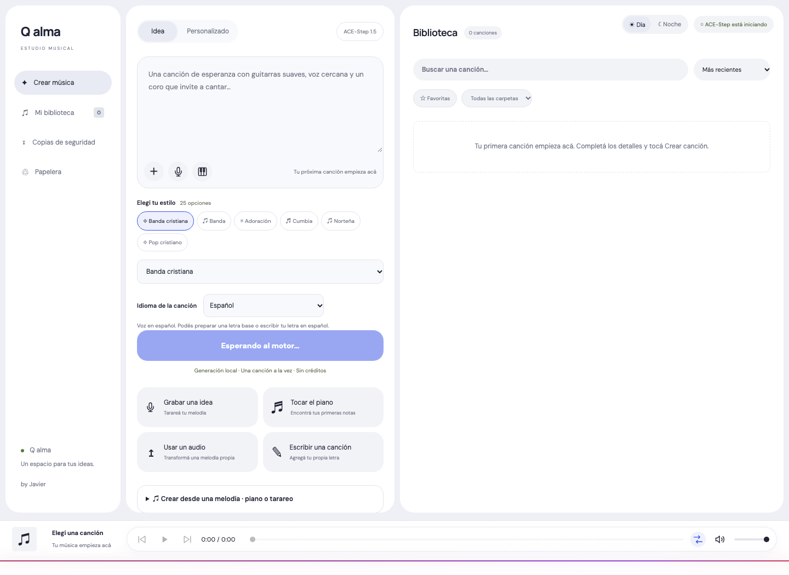

# Q Alma · Music Studio

Una interfaz en español para crear música con una instalación local de **ACE-Step 1.5**.
Cada persona ejecuta su propio motor, guarda sus canciones en su computadora y puede modificar
y compartir Alma. No requiere una cuenta de Alma, créditos ni suscripción.



## Qué incluye

- 25 estilos musicales y modo instrumental en cualquier género.
- Modo fácil con letras base editables para ocho temas. Son plantillas locales, no un servicio de escritura con IA.
- Voz masculina o femenina, ambiente, tempo y pruebas de 15 o 30 segundos y canciones de 1 a 5 minutos.
- Biblioteca local, reproductor, descarga de MP3 y creación de nuevas versiones.
- Eliminar canciones y videos a una papelera local y restaurarlos juntos. Se bloquea la eliminación durante trabajos activos.
- Importar escenas MP4/MOV/WebM de hasta 30 segundos y usarlas como fondo repetido con el audio de la canción. Si Wan Video está instalado en macOS, el editor permite abrir su lanzador. Wan y sus pesos se instalan por separado; esta función no utiliza un servicio de pago.
- Subir imágenes JPG, PNG o WebP (12 MB y 24 megapíxeles como máximo por imagen), seleccionar hasta ocho, ordenar escenas y agregar movimiento suave. La vista del diseño se actualiza antes de exportar.
- Ver y editar videos: título, colores, formato, canal, recorte del audio, volumen y ondas. Los cambios se aplican al exportar un MP4; el MP3 original se conserva.
- Crear videos MP4 con título, fondo propio y ondas animadas en horizontal o vertical (720p), con tres paletas y nombre de canal opcional. Requiere FFmpeg con libx264 y showwaves.
- Temas de día y noche, y borradores guardados en el navegador.

## Instalación

Esta primera versión se probó en macOS con Apple Silicon y 16 GB de RAM.
El motor ACE-Step también admite otras plataformas; la instalación de Alma en Windows/Linux
todavía necesita validación en equipos reales. Consultá los requisitos del motor para tu hardware.

1. Instalá **Python 3.11 o 3.12**, Git, uv y FFmpeg.
2. Instalá [ACE-Step 1.5 siguiendo su guía oficial](https://github.com/ace-step/ACE-Step-1.5/blob/main/docs/en/INSTALL.md).
   Los modelos se descargan por separado y ocupan varios GB. Abrí su interfaz local en el puerto **7860**.
   Desde la carpeta de ACE-Step, iniciá Gradio con el lanzador de tu sistema.

   | Sistema | Comando |
   | --- | --- |
   | macOS con Apple Silicon | `bash start_gradio_ui_macos.sh` |
   | Linux con NVIDIA | `bash start_gradio_ui.sh` |
   | Windows con NVIDIA | `.\start_gradio_ui.bat` |

   Si usás otro tipo de hardware, consultá la guía oficial para elegir el lanzador o la configuración compatible.
3. Descargá Alma y abrilo desde la terminal.

```sh
git clone https://github.com/gjagomez/music-studio.git
cd music-studio
python3 start.py
```

También podés [descargar el ZIP de Alma](https://github.com/gjagomez/music-studio/archive/refs/heads/main.zip),
descomprimirlo y ejecutar `python3 start.py` desde la carpeta extraída.

En Windows, usá `py -3.11 start.py`. La primera apertura instala las dependencias de la interfaz
en `.venv` y abre **http://127.0.0.1:7864**. Para generar, ACE-Step debe estar abierto y listo.
El instalador de Alma no instala ni descarga el motor automáticamente.

### Configuración para una Mac de 16 GB

En el archivo `.env` de ACE-Step, una configuración que funcionó para pruebas cortas fue:

```dotenv
ACESTEP_CONFIG_PATH=acestep-v15-turbo
ACESTEP_LM_MODEL_PATH=acestep-5Hz-lm-0.6B
ACESTEP_INIT_LLM=false
ACESTEP_LM_BACKEND=mlx
ACESTEP_MLX_VAE_FP16=1
ACESTEP_BATCH_SIZE=1
SERVER_NAME=127.0.0.1
PORT=7860
```

Empezá con 15 segundos y una sola generación. La configuración inicial agotó la memoria al generar
75 segundos. En esta Mac, una prueba de 60 segundos y una canción de 300 segundos terminaron usando `--device cpu --backend mlx`
(con el modelo auxiliar desactivado y VAE FP16). Ese modo mantiene los componentes PyTorch en CPU
y usa MLX para difusión y audio; puede tardar más y usar memoria virtual. Podés iniciarlo desde
la carpeta de ACE-Step con:

```sh
uv run acestep --device cpu --backend mlx --init_service true --init_llm false --batch_size 1 --config_path acestep-v15-turbo
```

Las canciones de varios minutos requieren más recursos. No se garantiza el mismo rendimiento en otros equipos.

## Creá tu primera canción

1. Abrí ACE-Step y esperá a que termine de cargar. Después abrí Alma en **http://127.0.0.1:7864**.
2. Elegí un género e idioma. Para cantar, elegí un tema y tocá **Preparar letra base**, o usá **Escribir mi canción** para agregar tu letra. Para crear una pista sin voz, marcá **Solo instrumentos**.
3. Elegí **15 segundos** para probar y tocá **Crear canción**.
4. Cuando termine, buscá tu canción en la **Biblioteca**, escuchala y descargá el MP3. Alma guarda las canciones en `data/`.

Si Alma indica que el motor está desconectado, comprobá que la interfaz Gradio de ACE-Step responda
en **http://127.0.0.1:7860** y que haya terminado de cargar el modelo.

La voz y los géneros son indicaciones para el modelo: los resultados varían y pueden contener artefactos.

Alma utiliza el endpoint Gradio `/generation_wrapper` de ACE-Step 1.5. Los cambios de esa interfaz
en futuras versiones del motor pueden requerir actualizar `engine.py`.
La revisión del motor probada fue `ca1e85fe9430179831e6bc6be790c332190a3866`.

### Comparar resultados

En **Personalizar el sonido**, elegí Estándar (8 pasos habituales de Turbo) o Rápido
(4 pasos, puede perder detalle). No cambia los pesos del modelo ni activa el modelo auxiliar.
La semilla se guarda en cada canción y aparece en la biblioteca. **Reutilizar ajustes**
recupera el perfil y la semilla; vaciala para crear una variación. Conservarla ayuda a
comparar perfiles con la misma letra, estilo y duración, sin garantizar audio idéntico
entre versiones del motor o hardware. Las canciones anteriores no tienen semilla registrada.

### Piano y tarareo

Abrí **Crear desde una melodía**. Podés tocar el piano con el mouse, pantalla táctil
o las teclas A W S E D F T G Y H U J K. **Grabar piano** captura el instrumento;
**Grabar tarareo** pide permiso al micrófono. Tocá **Detener y usar** para guardar
la guía. También podés subir WAV, MP3, M4A, OGG o WebM (1–30 segundos, hasta 20 MB).
La grabación se detiene automáticamente antes de los 30 segundos.

Elegí estilo y fuerza de seguimiento, y creá la canción. Para un arreglo sin voz,
marcá **Solo instrumentos**; para voz, revisá la letra. La guía se envía como audio de
origen en modo **cover**, no como referencia global de timbre. Es una reinterpretación
que puede cambiar notas. La duración depende de la guía y el motor; el selector de
duración queda desactivado mientras haya una guía. No extiende automáticamente un
fragmento corto a varios minutos. **Quitar guía** vuelve a la creación con texto.

Los audios se normalizan localmente con FFmpeg a WAV mono de 32 kHz y se conservan
en `data/_melodies`; también se copia la guía dentro de la canción. **Reutilizar ajustes**
recupera la guía anterior. El micrófono se apaga al terminar. No se descargan modelos nuevos.

## Privacidad y distribución

GitHub distribuye el código de Alma. Cada persona instala ACE-Step y descarga sus modelos por separado.
No publiques `data/`, `.env` ni `.venv`. Cada instalación empieza con su propia biblioteca.
Las fuentes visuales se solicitan a Google Fonts cuando hay internet; sin conexión se usan fuentes del sistema.
La generación ocurre localmente después de instalar los modelos.

Esta versión sirve **un estudio personal en localhost**. No es un servicio multiusuario ni está
preparada para exponerse directamente en internet. Una web pública de generación requiere un servidor
con GPU, cuentas, separación de bibliotecas y límites de uso, además del costo de operación.

## Licencias y créditos

El código de **Alma** se distribuye bajo [MIT](LICENSE): se puede usar, modificar, redistribuir
y utilizar comercialmente conservando el aviso de licencia.

Alma es una interfaz independiente y no es el proyecto oficial ACE-Step ni OpenSuno.
No incluye código o modelos de OpenSuno/YuE2.

- [ACE-Step 1.5](https://github.com/ace-step/ACE-Step-1.5) es el motor, desarrollado por ACE-Step y distribuido bajo MIT.
- [Los modelos oficiales ACE-Step 1.5](https://huggingface.co/ACE-Step/Ace-Step1.5) indican licencia MIT y permiten uso comercial de la música generada.
- FastAPI, Uvicorn, Requests, Pydantic y Gradio Client conservan sus respectivas licencias.
- Las fuentes DM Sans y Manrope se sirven desde Google Fonts bajo sus licencias abiertas.

La licencia de Alma no cambia las licencias de otros componentes ni concede derechos sobre letras,
grabaciones o voces de terceros. La posibilidad de monetizar también depende de las reglas de cada plataforma.

## Comprobaciones

```sh
python -m pip install httpx
python -m unittest discover -v
node --check web/app.js
node --check web/presets.js
node --check web/theme.js
```

Los tests usan un motor simulado y no generan canciones. Requieren `httpx`, disponible en el entorno
del motor; en el entorno independiente se puede instalar con `python -m pip install httpx`.

## Herramientas de biblioteca

- **Editar audio** permite recortar, ajustar volumen y aplicar entrada/salida suave. Guarda
  una canción nueva y conserva el MP3 original. La vista previa reproduce el recorte.
- **2–3 versiones** genera alternativas de una canción usando la misma letra y estilo con
  semillas distintas. Las procesa una por una y conserva los resultados aunque una falle.
- La estrella marca favoritas. **Organizar** permite asignar una carpeta virtual y notas.
  Los filtros y la búsqueda también consideran carpetas y notas. Estos datos se guardan
  separados de los parámetros de generación.
- En **Crear video → Letra sincronizada**, prepará un borrador LRC y corregí cada tiempo
  o marcá las frases mientras escuchás. Los tiempos iniciales son aproximados, no una
  alineación automática. La exportación incluye los textos con sus tiempos, incluso en
  instalaciones de FFmpeg sin libass. Los tiempos se miden en la canción original.
- **Copias de seguridad** exporta biblioteca, papelera, guías y configuraciones a un ZIP.
  Conserva una copia en `data/_backups` y permite descargarla. Restaurar agrega canciones
  faltantes, sin sobrescribir IDs que ya existan en biblioteca o papelera. Admite ZIP de
  hasta 2 GB y contenido descomprimido de hasta 4 GB. Las copias requieren que terminen
  los trabajos activos. No incluyen modelos ni entornos de Python.

Comprobación adicional: `python -m unittest -v test_features`.

### Idioma de la canción

El selector **Idioma de la canción** permite español o inglés. Se guarda con cada canción,
con el borrador y con las variantes. El motor recibe `es` o `en` para la voz; en instrumentales
no se aplica. Las letras base tienen versiones en ambos idiomas. Cambiar de idioma adapta
solo una plantilla sin editar; una letra propia se conserva y no se traduce automáticamente.
Las canciones anteriores se consideran en español cuando no tienen el campo guardado.

## Personaje cantando

En una canción terminada, tocá **Personaje cantando** (también está dentro de Crear video).
Subí una foto JPG/PNG/WebP o un video de hasta 30 segundos, elegí el inicio de la canción,
un fragmento de 5, 10, 15 o 30 segundos, y el formato YouTube/Reels. Cada animación se
guarda por separado y conserva la voz y música de ese fragmento. Las fotos animan la boca;
los videos aportan el movimiento original. Para limitar memoria se usan hasta cinco segundos
del video base y se alternan hacia adelante y atrás durante la animación.

La función opcional de personajes se probó con [MuseTalk para Apple Silicon](https://github.com/barnent1/musetalk-mac),
revisión `7fd019315127d7f31e2e7f9853547ddceabbeb6e`, en `~/Alma-Avatar`, con su propio
entorno `.venv`. Los componentes VAE/UNet faltantes se recuperaron del
[repositorio oficial](https://github.com/TMElyralab/MuseTalk/tree/main/musetalk/models).
Los pesos públicos son MuseTalk 1.5, SD-VAE, Whisper-tiny y BiSeNet. Se descargan aparte
(unos 4 GB); no se incluyen en las copias de seguridad ni en la distribución de Alma.
El entorno musical no se modifica. Para recuperar una instalación existente, ejecutar
`~/Alma-Avatar/.venv/bin/python ~/Alma-Avatar/install_models.py`.

`tools/avatar_infer.py` adapta la inferencia a procesos cortos, batch de un rostro,
15 FPS, máscaras almacenadas en memoria y escritura de cuadros por streaming a FFmpeg.
El proceso termina al completar el trabajo, liberando sus modelos. Puede elegirse Apple
Silicon (MPS) o CPU. La creación de música y las copias esperan durante una animación.
Si no se encuentra rostro, la operación falla con un mensaje; nunca se presenta una
imagen estática como si fuera sincronización de labios. Los registros están en
`data/<canción>/avatars/<trabajo>/inference.log`. No se usan servicios de pago ni TTS.

Se validó una prueba real de 1,2 segundos usando el rostro de ejemplo de MuseTalk y
un fragmento musical local; las pruebas de API usan un motor simulado. El modelo está
orientado a sincronizar labios, no a animar todo el cuerpo. La precisión con canto y
mezclas musicales varía: empezá con cinco segundos y una voz que se escuche clara.
